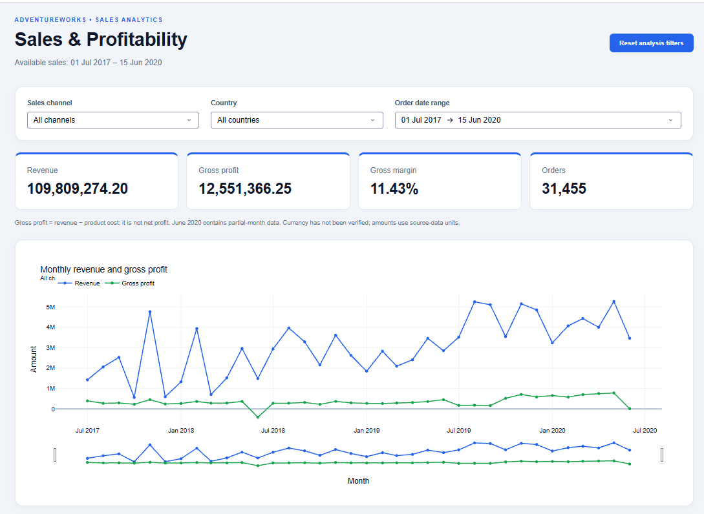
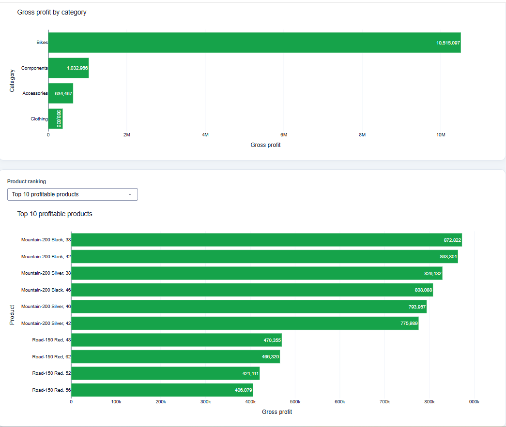
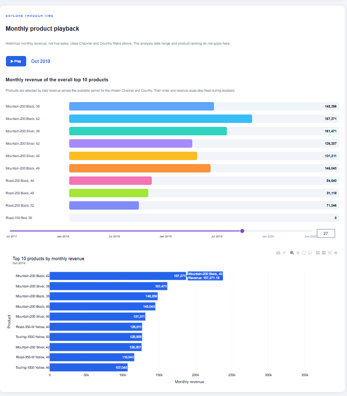

# AdventureWorks Sales & Profitability Dashboard

An end-to-end sales analytics portfolio project by **Md Abdul Wahid Raju**, using Python, pandas, Plotly and Dash. The analysis connects revenue growth to gross profitability across channels, countries, categories and products.

## Video demo

[▶ Watch the two-minute dashboard demo on LinkedIn](https://lnkd.in/p/e4CsK4Cb)



## Business questions

- Does the highest-revenue sales channel also deliver the strongest gross margin?
- Which categories and products contribute to gross profit or losses?
- How do sales and profitability vary over time and across countries?
- Which products lead monthly revenue, and how does their performance change?

## Results

| Metric | Full available period |
|---|---:|
| Sales lines | 121,253 |
| Orders | 31,455 |
| Revenue | 109,809,274.20 |
| Gross profit | 12,551,366.25 |
| Gross margin | 11.43% |
| Dates | 1 July 2017–15 June 2020 |

Reseller generated approximately **80.45 million** revenue with a **0.58%** gross margin. Internet generated **29.36 million** revenue with a **41.15%** gross margin. This suggests that channel performance should be assessed using both revenue and margin.

Reseller Bikes recorded approximately **990,700 in gross losses** across the available period, warranting further investigation of pricing, product costs and sales mix. These are descriptive findings from sample data, not evidence of a causal explanation.

## Dashboard features

- Channel, country and inclusive date-range filters.
- Revenue, gross profit, gross margin and unique order KPI cards.
- Monthly revenue and gross profit trends with a range slider.
- Category gross profit and top profitable/loss-making products.
- Play/pause controls and a monthly playback slider.
- Smooth CSS bars for the overall top 10 products, using fixed product order and revenue scale within each Channel/Country selection.
- A separate chart for each month's top 10 products; this membership can change monthly.
- Empty-result messages and reset analysis filters.

Playback uses historical monthly data and Channel/Country filters. The analysis date range and profit/loss ranking do not apply to playback.

## Screenshots





## Run locally

Use Python 3.11 or newer. From the repository root:

```bash
python -m venv .venv
```

Activate on Windows PowerShell:

```powershell
.venv\Scripts\Activate.ps1
```

Or on macOS/Linux:

```bash
source .venv/bin/activate
```

Install dependencies and launch:

```bash
python -m pip install -r requirements.txt
python app/app.py
```

Open http://127.0.0.1:8050/ in your browser. This address runs locally; the GitHub repository itself does not host the Dash application.

## Reproduce the notebook

See [data instructions](data/README.md) to download Microsoft's original Excel workbook into `data/`. Run:

```bash
jupyter notebook notebooks/sales_analysis.ipynb
```

Run all cells in order. The notebook exports `data/processed/sales_dashboard.csv` and validates the saved totals. Paths resolve from the repository root or its `notebooks` directory.

## Project files

| Path | Purpose |
|---|---|
| `app/app.py` | Dashboard layout, charts and callbacks |
| `app/assets/dashboard.css` | Animated bars and responsive styling |
| `notebooks/sales_analysis.ipynb` | Data checks, joins, exploration and findings |
| `data/processed/sales_dashboard.csv` | Dashboard input |
| `screenshots/` | Dashboard previews |

## Definitions and limitations

- Gross profit = Sales Amount − Total Product Cost; operating expenses are excluded.
- Gross margin = total gross profit / total revenue × 100; zero revenue displays N/A.
- Orders are counted using distinct Sales Order values within the selection.
- June 2020 is a partial month and should not be compared directly with complete months.
- Currency is unverified; amounts are shown in source-data units.
- Source discount percentages are zero despite discrepancies between unit price × quantity and sales amount. Inferred reductions are not treated as verified discounts.
- Product names are aggregated across product keys. Negative gross-profit records are retained.

## Source

[Microsoft Learn: From dimensional model to stunning report in Power BI Desktop](https://learn.microsoft.com/en-us/power-bi/create-reports/desktop-dimensional-model-report), which provides the AdventureWorks Sales sample Excel workbook. This portfolio implements its own analysis and Python dashboard using that sample data.
